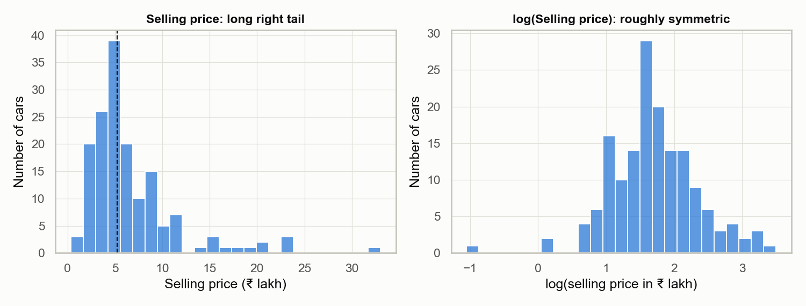
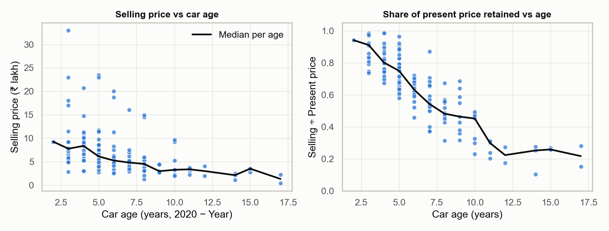
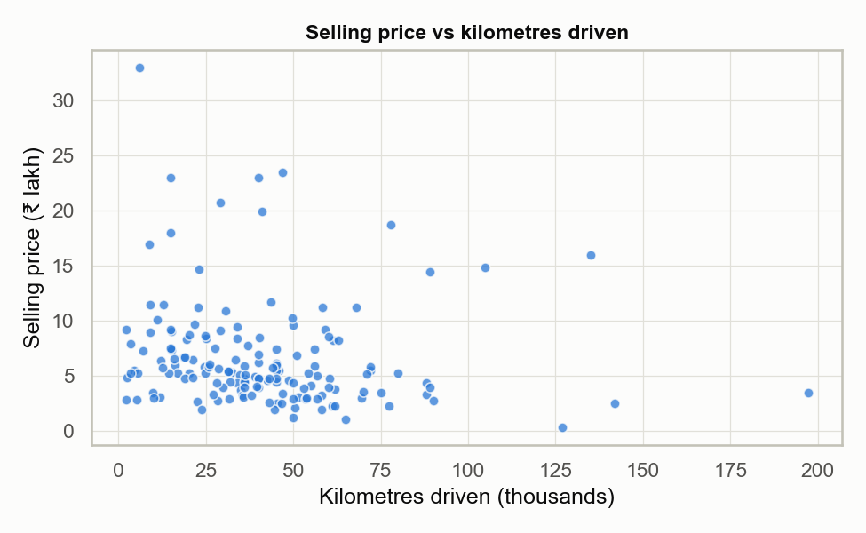
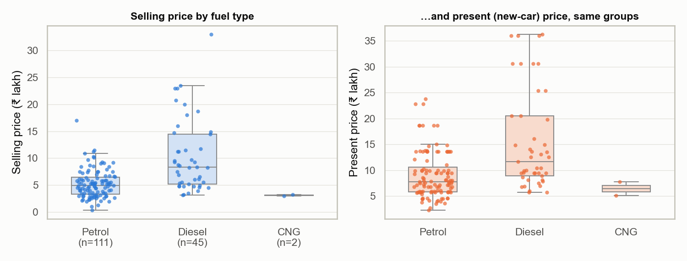
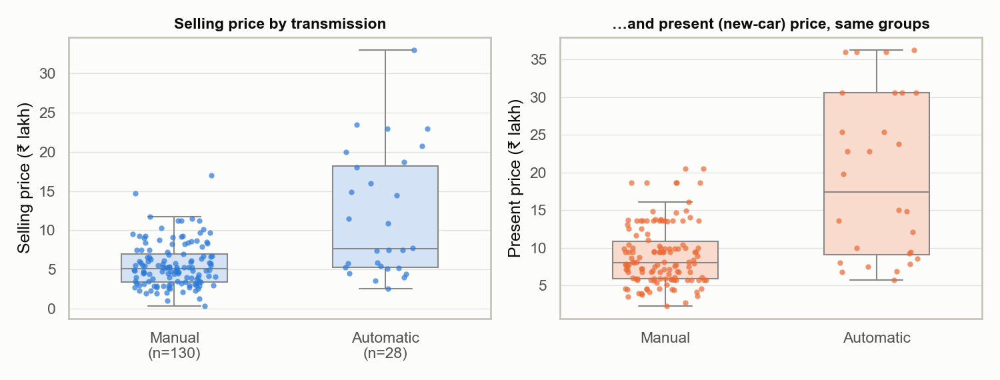
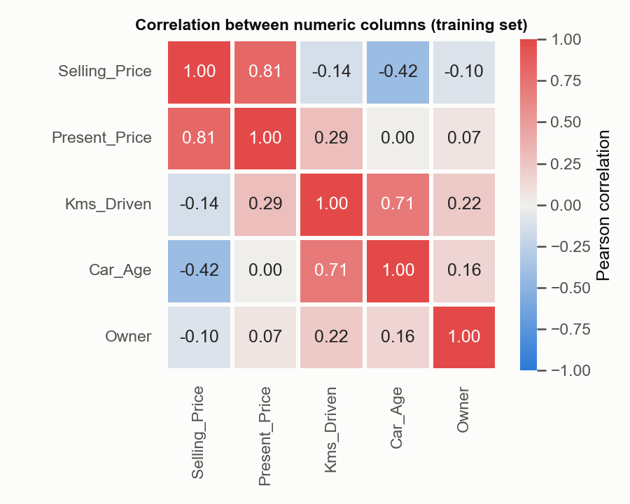
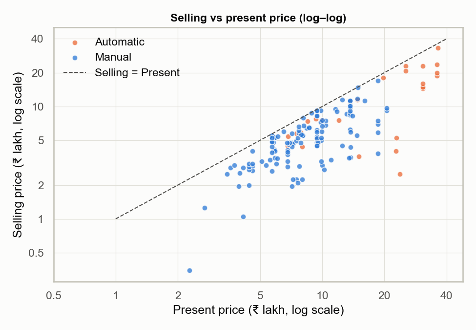
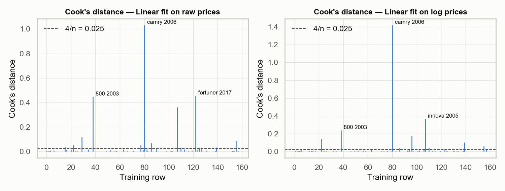

# EDA Findings (Stage 2)

Reproduce with:

```
python -m src.data_preprocessing
python -m src.eda
```

All figures and numbers below use the **158-car training split** only
(seed 42, 80/20; see decision D6). The 40 test cars were not inspected
except for their feature ranges. Every number quoted here is in
`reports/eda_summary.json`. Prices are in ₹ lakh.

Correlation describes association in this sample. It does not show that
one variable causes another.

---

## 1. How is the selling price distributed?


- Median 5.25, mean 6.67, range 0.35–33.0. Half of the cars sell for
  between 3.76 and 8.16.
- The distribution is strongly **right-skewed** (skewness 2.38). A small
  group of Fortuners, Innovas and one Corolla Altis sells for 15–33, far above the rest.
- After taking the logarithm, the distribution is roughly symmetric
  (skewness −0.19).

**Why it matters:** an ordinary linear model on raw prices will be pulled
toward the few expensive cars. Its errors will also likely be larger for
expensive cars than for cheap ones, which breaks the constant-variance
assumption. A log-price target is a candidate for Stage 3 (see the open
item in the decision log).

## 2. How does selling price relate to car age?


- **Left:** older cars sell for less (Pearson −0.42, Spearman −0.59). The
  link is clear but noisy, because a 3-year-old Fortuner and a 3-year-old
  Alto are very different cars.
- **Right:** dividing by the present (new-car) price removes most of that
  noise. The share of value retained falls steadily with age, from
  about 0.94 at 2 years to 0.75 at 5, 0.45 at 10, and around 0.22–0.26 for
  cars aged 12 or more (correlation −0.87).

**Interpretation:** cars lose a roughly constant *percentage* of their
value each year, rather than a constant number of lakhs. A model on raw
prices assumes every car loses the same number of lakhs per year, whether
it is a Fortuner or an Alto. A model on log prices can express
"loses about x % per year", which matches this pattern better.

## 3. How does selling price relate to kilometres driven?


- Weak negative association (Pearson −0.14, Spearman −0.28).
- Kilometres and age are strongly linked (correlation 0.71), because older
  cars have usually been driven further. Much of the apparent "km effect"
  is therefore probably an age effect. In the model, the km coefficient
  measures the effect of extra km *for cars of the same age*, and it will
  be estimated less precisely because of this overlap.
- Five training cars have more than 100,000 km. Three are 14–17 years old
  (800, camry, innova) and show up as influential in question 7. The
  other two are 7–8-year-old Fortuners.

## 4. How do prices differ across fuel types?


| Fuel | n | Median selling | Median present | Median share retained |
|---|---|---|---|---|
| Petrol | 111 | 4.90 | 7.71 | 0.66 |
| Diesel | 45 | 8.35 | 11.60 | 0.67 |
| CNG | 2 | 3.10 | 6.42 | 0.51 |

Diesel cars sell for more, but they also cost more new. The share of
value retained is almost the same for diesel and petrol (0.67 vs 0.66).
So most of the raw price gap reflects *which* cars are diesel (larger
SUVs and MPVs), not diesel itself. Once `Present_Price` is in the model,
expect the fuel coefficient to be small. Two CNG cars are too few to
draw any conclusion.

## 5. How do prices differ between manual and automatic?


| Transmission | n | Median selling | Median present | Median share retained |
|---|---|---|---|---|
| Manual | 130 | 5.10 | 8.02 | 0.66 |
| Automatic | 28 | 7.62 | 17.41 | 0.70 |

The same pattern as fuel. Automatics are mostly expensive models (their
median present price is more than double), so the raw gap is mostly a
price-segment effect. Their retained share is only slightly higher. The
model will separate the two influences. Its transmission coefficient
answers a narrower question: what is the price difference between cars
with the same present price, age and km?

## 6. How do the numerical features correlate with the target?


| Feature | Pearson with price | Spearman with price |
|---|---|---|
| Present_Price | 0.81 | 0.70 |
| Car_Age | −0.42 | −0.59 |
| Kms_Driven | −0.14 | −0.28 |
| Owner | −0.10 | −0.13 |

- `Present_Price` is by far the strongest single predictor. This is
  expected, because it measures what class of car it is.
- `Car_Age` and `Present_Price` are uncorrelated (0.00), so each adds
  separate information.
- **Multicollinearity check (variance inflation factors, VIF):** Present
  price 1.96, km 2.76, age 2.34, owner 1.16, seller 1.32, transmission
  1.54. These are all below the common warning level of 5. The exception
  is **the fuel dummies (VIF ≈ 17)**. This is an encoding artefact. With
  CNG as the dropped reference level, which happens by default because it
  is first alphabetically, the Diesel and Petrol columns almost add up to
  1, since only 2 cars are CNG. Using Petrol, the common case, as the
  reference fixes this. Logged as an open item for Stage 3.
- `Owner` is weakly related to price, but 153 of 158 training cars have
  0 previous owners. The correlation rests on 5 cars.
- `Seller_Type`: the 5 individual-seller cars have a median retained
  share of 0.27, against 0.66 for dealers. Most of them are old cars, so
  this is not evidence that individual sellers get lower prices:
  three of the five are 14–17 years old (800, camry, innova).

## 7. Which observations are potentially influential or anomalous?



The diagnostic is a plain least-squares fit with all candidate features
on the training data, done twice: once on raw prices and once on log
prices. Cook's distance measures how much the whole fit moves when one
car is removed. The 4/n = 0.025 rule flags 13 rows (raw fit) and 12 rows
(log fit) for a look. Cook's distance values above about 0.5–1 are the
ones that really matter.

| Car | Year | Sold | Present | Km | Cook's D (raw / log) | Why it stands out |
|---|---|---|---|---|---|---|
| camry | 2006 | 2.50 | 23.73 | 142,000 | **1.03 / 1.42** | Retains only 11 % of its new price. It is the only car with 3 previous owners. |
| fortuner | 2017 | 33.00 | 36.23 | 6,000 | 0.45 / — | Most expensive training car. Influential only on the raw scale. |
| 800 | 2003 | 0.35 | 2.28 | 127,000 | 0.45 / 0.24 | Cheapest and oldest car |
| innova | 2005 | 3.49 | 13.46 | 197,176 | 0.36 / 0.36 | Highest km in the data |

- None of these are data errors. A 14-year-old luxury sedan with three
  previous owners can plausibly sell at 11 % of the new price. They stay in
  the data, in line with decision D4.
- The camry carries the only `Owner = 3` value. Any coefficient for owner
  count will largely reflect this one car.
- The expensive Fortuner is influential only on the raw-price scale. This
  is a second sign that the log scale handles the price range better.
- **Test-set extrapolation (features only):** one test car, the
  **land cruiser** (present price 92.6, against a training maximum of
  36.23), is outside the training range. Any linear model must
  extrapolate far beyond its data for it, so a large error is likely
  regardless of model quality. See decision D7 for how this is reported.
- The test set happens to contain **no** CNG, individual-seller or
  previously-owned cars. Coefficients for those levels will not be tested
  at all on held-out data.

---

## Summary for Stage 3
1. `Present_Price` and `Car_Age` carry most of the signal. Km adds little
   once age is known.
2. The data show percentage-style depreciation and a skewed target, so
   compare a raw-price target with a log-price target using
   cross-validation on the training set.
3. Use Petrol as the fuel reference level.
4. Treat the seller, owner and CNG coefficients as unreliable (each rests
   on 2–5 cars). Either drop or keep these features, decided on domain
   grounds before any test score is seen.
5. Expect test-set RMSE to be dominated by the land cruiser.
