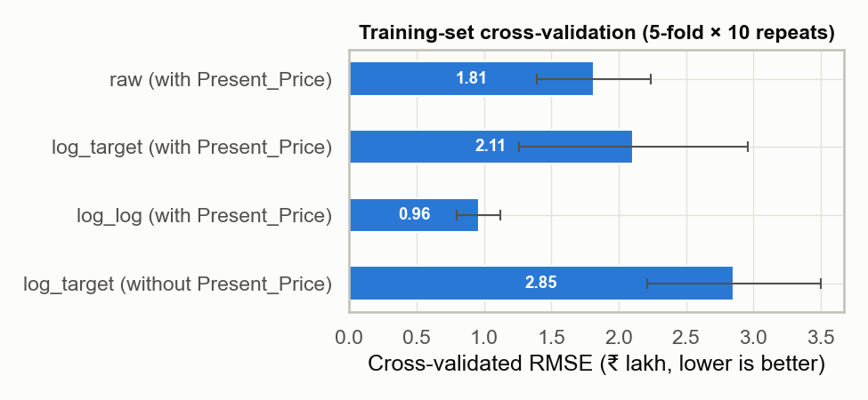
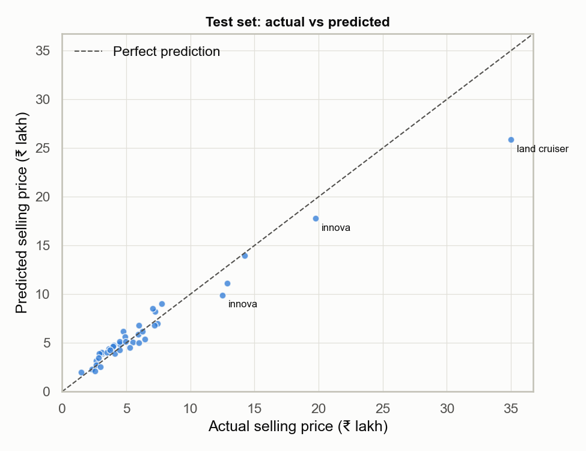
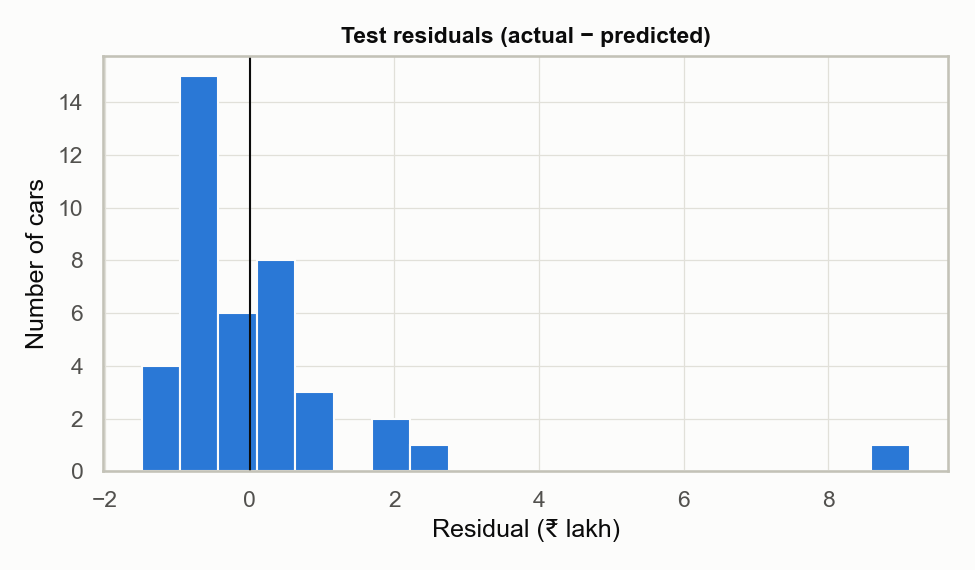
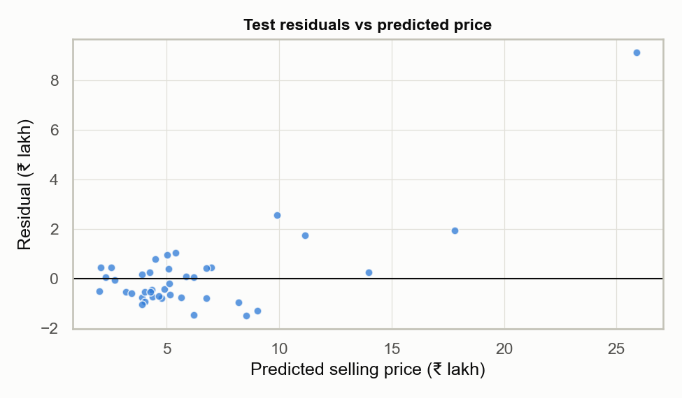

# Model Results (Stage 3)

Reproduce with:

```
python -m src.data_preprocessing
python -m src.train
```

Every number below is copied from `reports/model_metrics.json`,
`reports/coefficients.csv` or `reports/test_predictions.csv`. Prices are
in ₹ lakh (1 lakh = ₹100,000).

## 1. What was built
A scikit-learn pipeline that takes five inputs: `Year`, `Present_Price`,
`Kms_Driven`, `Fuel_Type` and `Transmission`. Inside the pipeline:

1. `Year` → `Car_Age = 2020 − Year`
2. `Present_Price` → `log(Present_Price)`
3. `Fuel_Type`, `Transmission` → one-hot columns (reference: Petrol, Manual)
4. `LinearRegression` fits **log(Selling_Price)** as a weighted sum of these
5. The prediction is converted back with `exp(...)`, giving lakhs

So the fitted equation is

```
log(Selling_Price) = b0 + b1·Car_Age + b2·Kms_Driven + b3·log(Present_Price)
                     + b4·[CNG] + b5·[Diesel] + b6·[Automatic]
```

This is still **Multiple Linear Regression**: the model is linear in
its coefficients, and only the scale of the price columns changed. No
feature scaling is used, because least squares does not need it.
Seller type and owner count are excluded (decision D8).

## 2. How the target scale was chosen (training data only)
Three pre-declared variants were compared by 5-fold cross-validation
repeated 10 times on the 158 training cars (decision D10). The rule was
fixed beforehand: lowest mean RMSE wins.



| Variant | CV MAE | CV RMSE (± sd) | CV R² |
|---|---|---|---|
| raw: price ~ features | 1.242 | 1.815 ± 0.422 | 0.838 |
| log_target: log price ~ features | 1.157 | 2.107 ± 0.850 | 0.779 |
| **log_log: log price ~ log present price + others** | **0.708** | **0.962 ± 0.162** | **0.953** |

`log_log` wins clearly. It is also the one that matches the EDA finding
that cars lose a *share* of their new price each year. Logging only the
target (`log_target`) is worse than raw. Its predictions blow up for
expensive cars, because `exp(... + b·Present_Price)` grows exponentially
with present price, while the real relation is closer to proportional.

## 3. Results

| Data | n | MAE | RMSE | R² |
|---|---|---|---|---|
| Training set (fit) | 158 | 0.673 | 0.912 | 0.964 |
| Training set (cross-validated) | 158 | 0.708 | 0.962 | 0.953 |
| **Test set, all cars (headline)** | **40** | **0.935** | **1.696** | **0.915** |
| Test set, inside training ranges (D7) | 39 | 0.725 | 0.902 | 0.938 |

**What the metrics mean here**
- **MAE 0.935:** on average, a test-car prediction is off by about
  ₹93,500 in either direction. The median test error is 15 % of the car's
  price, and 31 of the 40 cars are within ₹1 lakh.
- **RMSE 1.696:** like MAE, but squaring punishes big misses more. It is
  almost double the MAE because of one car: the land cruiser alone is off
  by 9.12. Without it, RMSE (0.902) is close to MAE (0.725), so the other
  errors are fairly even in size.
- **R² 0.915:** the model accounts for about 92 % of the variation in test
  prices *around their mean*. Much of that comes from `Present_Price`
  separating cheap models from expensive ones, which is a relatively easy
  task. R² does not say that individual predictions are accurate; MAE and
  the table below do.

**Overfitting check:** training RMSE (0.91), cross-validated RMSE (0.96)
and test RMSE on in-range cars (0.90) are all similar. A model that had
memorised its training data would show a much lower training error than
test error. This one does not, which is expected with only 7 coefficients
for 158 cars.

## 4. Predictions on the test set


Selected rows from `reports/test_predictions.csv`, sorted by error:

| Car | Year | Present | Actual | Predicted | Abs. error |
|---|---|---|---|---|---|
| i20 | 2016 | 7.60 | 6.25 | 6.19 | 0.06 |
| verna (diesel) | 2013 | 9.40 | 5.95 | 5.86 | 0.09 |
| corolla altis | 2016 | 20.91 | 14.25 | 13.98 | 0.27 |
| amaze | 2014 | 7.00 | 3.65 | 4.37 | 0.72 |
| eon | 2016 | 4.43 | 2.90 | 3.92 | 1.02 |
| corolla altis | 2013 | 18.61 | 7.05 | 8.55 | 1.50 |
| creta (diesel) | 2016 | 13.60 | 12.90 | 11.14 | 1.76 |
| innova (automatic) | 2017 | 23.15 | 19.75 | 17.81 | 1.94 |
| innova (diesel) | 2015 | 13.46 | 12.50 | 9.92 | 2.58 |
| land cruiser | 2010 | 92.60 | 35.00 | 25.88 | 9.12 |

## 5. Residual analysis



A residual is actual − predicted. A positive residual means the model
predicted too low.

- **Cheaper cars (predicted below 10 lakh, 36 cars):** residuals mostly fall
  between −1.5 and +2.6, with a mean of −0.22. The model slightly
  *over*-predicts these cars on average (22 of 36).
- **Expensive cars:** all 5 test cars that actually sold for more than 12
  lakh (corolla altis 2016, creta, two innovas, land cruiser) are
  *under*-predicted. This is a systematic pattern, not random noise. The
  model keeps less of a high present price than these SUVs and MPVs
  actually retained in this data. The model has no brand or model
  feature, so it cannot learn that particular models hold their value
  better than others. The `exp()` conversion also returns a median-type estimate,
  which slightly lowers predictions (D10 caveat).
- **The land cruiser** (actual 35.0, predicted 25.88) has a present
  price of 92.6, 2.5× the training maximum (36.23). No training car is
  anywhere near it, so this is extrapolation. It was flagged in Stage 2
  before any model existed (D7).

## 6. Coefficients
From `reports/coefficients.csv`. On the log scale, a coefficient *b*
multiplies the price by *e^b*, shown as a percentage change. Each effect
assumes **all other inputs stay the same**.

| Term | Coefficient | Meaning |
|---|---|---|
| (intercept) | 0.590 | Baseline; not meaningful alone (no car has all inputs at 0) |
| Car_Age | −0.1016 | **−9.7 %** selling price per extra year of age |
| Kms_Driven | −0.0000028 | **−2.8 %** per 10,000 km driven |
| log_Present_Price | 0.818 | A car whose new price is 1 % higher sells for about **0.82 %** more |
| Fuel_Type_Diesel | 0.192 | **+21.1 %** for diesel vs petrol |
| Transmission_Automatic | 0.054 | **+5.6 %** for automatic vs manual |
| Fuel_Type_CNG | −0.132 | −12.4 % for CNG vs petrol — **unreliable: based on 2 cars** |

**Reading the coefficients**
- **Age** is the main depreciation driver: roughly 10 % per year,
  compounding. A car loses about 40 % of its value over 5 years
  (0.903⁵ ≈ 0.60).
- **Kilometres** matter less once age is known. Age and km are correlated
  (0.71), so this coefficient is the *extra* effect of km for cars of the
  same age, and it is less precise.
- **Present price elasticity 0.82 < 1:** expensive cars keep a slightly
  smaller *share* of their new price than cheap ones, according to the
  model. Section 5 shows that this under-predicts popular expensive
  models.
- **Diesel +21 %:** within this data, diesel cars resell higher than
  petrol cars with the same new price, age and km. EDA showed a raw gap
  that was mostly a car-class effect. This coefficient is what remains
  after removing it. It is an association in this sample, not proof that
  diesel causes a higher price. For example, it may partly reflect which
  diesel models (Innova, Fortuner) appear in the data.
- **Automatic +5.6 %:** small. Only 28 training cars are automatic, and
  the effect is tangled up with luxury models, so treat it as rough.

## 7. Secondary experiment: without `Present_Price`
Same target scale (log price), inputs `Year`, `Kms_Driven`, `Fuel_Type`,
`Transmission` only.

| | With Present_Price | Without |
|---|---|---|
| CV RMSE (train) | 0.962 | 2.855 |
| CV R² (train) | 0.953 | 0.620 |
| Test MAE / RMSE / R², all 40 | 0.935 / 1.696 / 0.915 | 2.603 / 5.476 / 0.111 |
| Test MAE / RMSE / R², same 39 cars | 0.725 / 0.902 / 0.938 | 1.894 / 2.705 / 0.438 |
| Land cruiser predicted (actual 35.0) | 25.88 | 4.77 |

Without `Present_Price`, the model has no way to tell an Alto from a
Fortuner of the same age. Errors roughly triple. The land cruiser is
predicted at 4.77 lakh, as if it were an ordinary 10-year-old diesel car.

**Why `Present_Price` is a legitimate input:** it is the current
showroom price of the *model*, which a seller can look up before listing,
so it is available at prediction time. It is not derived from the
selling price. **Cost:** the user must look it up, and for discontinued
models it is not well defined.

## 8. Limitations
1. **Small data.** 158 training and 40 test cars. The test metrics would
   shift noticeably with a different random split. The CV spread
   (RMSE sd 0.16) gives a sense of this.
2. **Systematic under-prediction of expensive, high-retention models**
   (Innova, Creta, Fortuner-type cars). Predictions above about 10 lakh
   should be treated as likely too low.
3. **No extrapolation guarantee.** Present prices above 36.23 lakh, or ages
   and km outside the training ranges, are outside the data. The app
   should warn about this.
4. **Untested coefficients.** The test set has no CNG cars, so the CNG
   coefficient (2 training cars) was never checked on held-out data.
5. **No brand, model, condition, location or date features.** Two cars
   with identical inputs can differ in price for reasons the model cannot
   see.
6. **Old market.** Listings from around 2018–2020. These are not today's prices.
